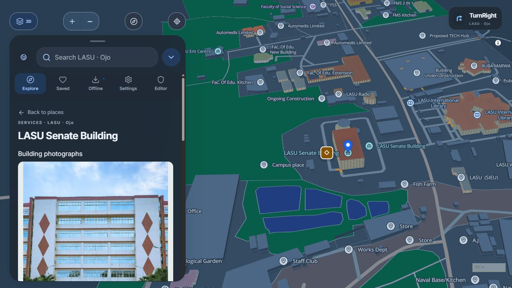
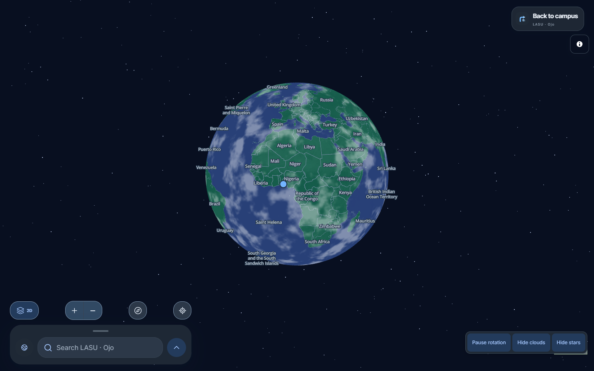
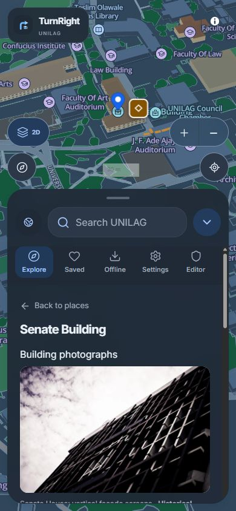
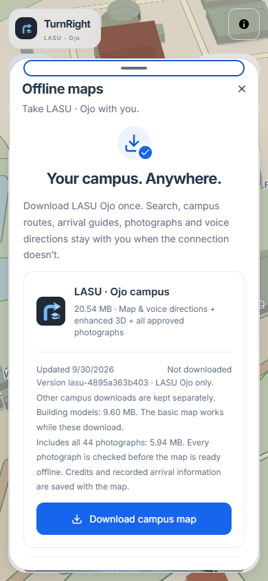
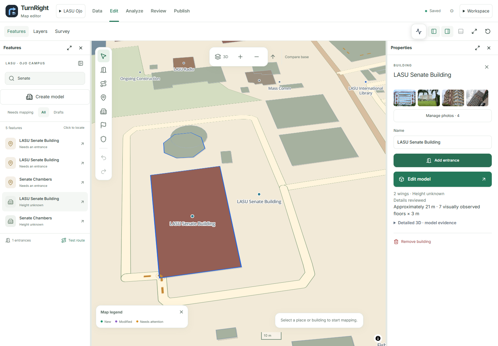
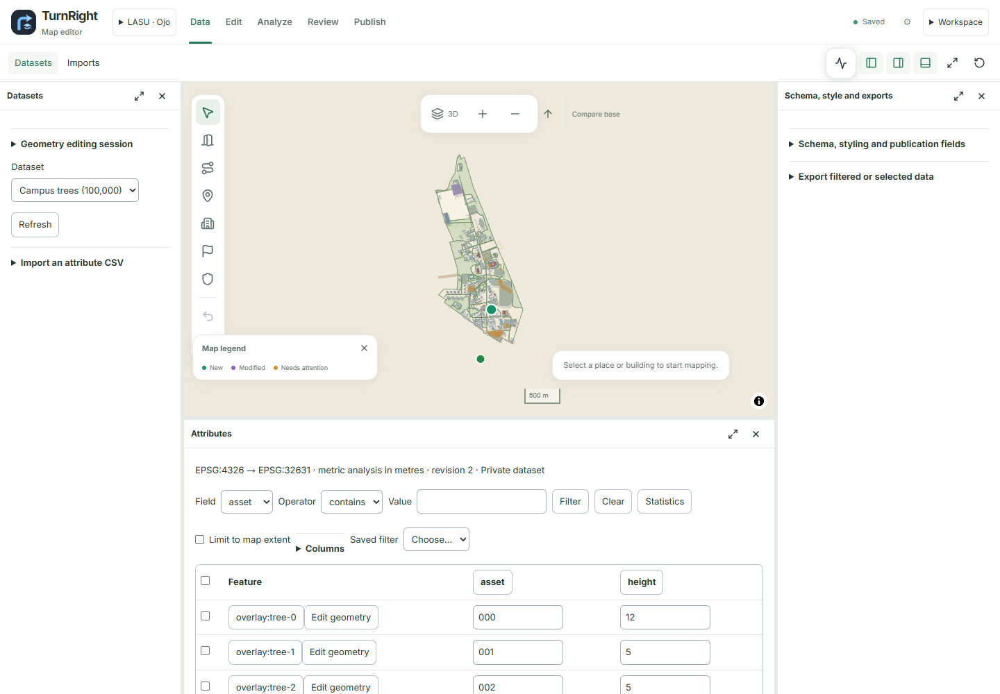
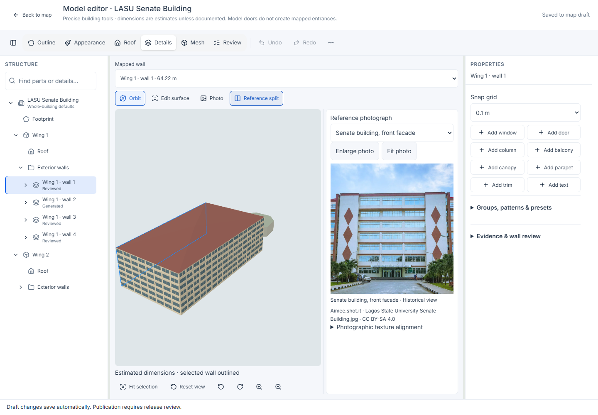
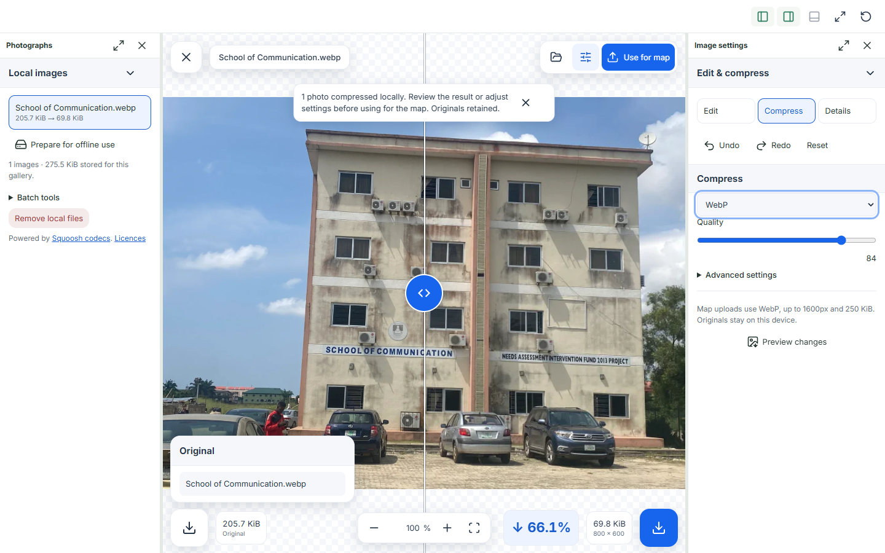
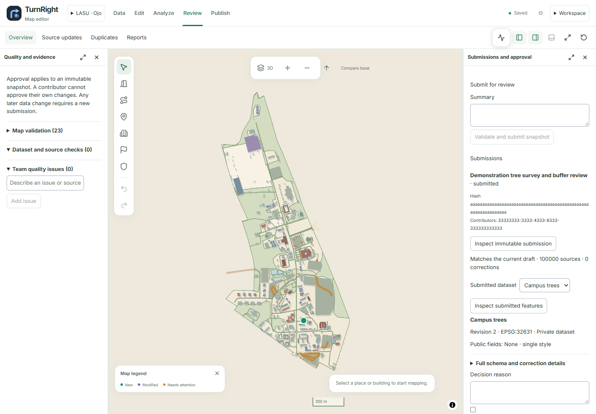
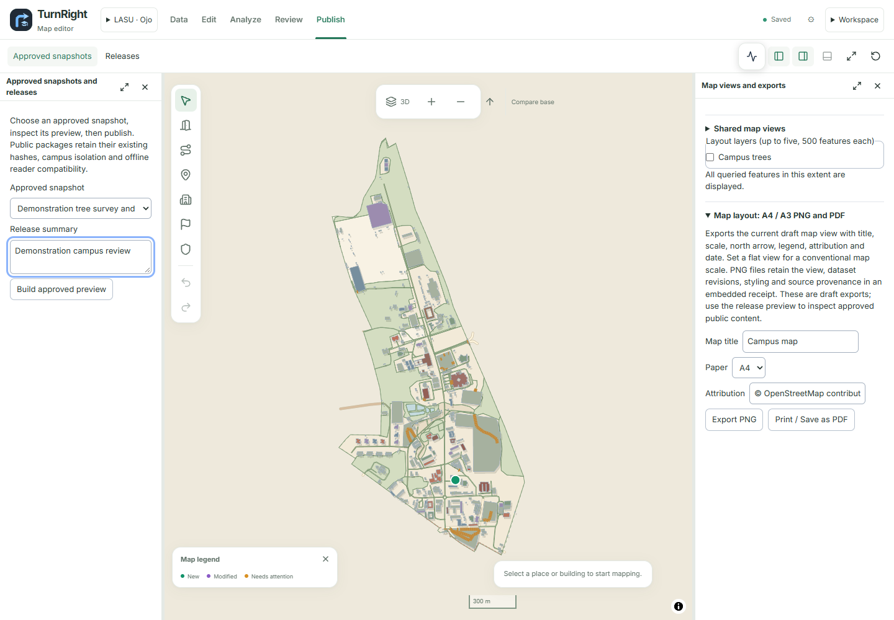

<picture>
  <source media="(prefers-color-scheme: dark)" srcset="docs/assets/brand/wordmark-reversed.svg">
  
</picture>

# TurnRight

**Explore a campus. Build a better map.**

TurnRight combines a public campus map and globe with a private GIS editor. Visitors can discover campuses, inspect places and buildings, plan journeys, and download maps for offline use. Campus teams can import data, edit geometry and building models, review source changes, and publish independently approved map releases.

[Explore the map](https://turnright.vercel.app/) · [Open the editor](https://turnright.vercel.app/admin) · [Documentation](docs/README.md) · [Contributing](CONTRIBUTING.md)

> Independent project; not an official university service. Routes and entrances still require field verification. Building models and mapped approaches do not establish access or step-free accessibility. See [release readiness](docs/PRODUCTION.md) for verification status and remaining checks.

## Public map and globe

### Discover and explore

Start with the campus map or open **Choose a campus** to explore the globe. Select a published campus by name, pin, or boundary. The existing map stays open during switching, and unavailable downloads leave the current campus usable. [LASU Ojo](https://turnright.vercel.app/?campus=lasu) and [UNILAG Akoka](https://turnright.vercel.app/?campus=unilag) have separate published packages; campus identity follows shared links, saved places, and offline downloads.

| Campus map                                                                                                                | World view                                                                                                          |
| ------------------------------------------------------------------------------------------------------------------------- | ------------------------------------------------------------------------------------------------------------------- |
|  |  |

- Search destinations and streets, browse categories, save places, and share destination links.
- Switch between 2D and 3D, use light/dark/device appearance, and adjust map rendering and motion settings.
- Inspect building footprints, authored models, photographs, source credits, and arrival information. Recorded, estimated, and illustrative dimensions remain distinguishable.
- Submit a correction report or keep a local report draft for later. Reports enter private review and do not immediately change the map.

### Navigate and prepare for offline use

Preview walking or driving routes from a selected origin. Foreground GPS, route instructions, spoken guidance, and deviation handling support a journey over the mapped network. Driving includes mapped vehicle restrictions, parking, and a walking handoff where available.

Download each campus from **Offline** and wait for **Ready offline** before disconnecting. Verified packages retain the map, search, routing, and recorded guidance; photo/model assets follow the package's download controls and verification. Updates preserve the active journey and the preceding valid package until a replacement is ready.

| Place details on a phone                                                                                                                              | Offline preparation                                                                                                                 |
| ----------------------------------------------------------------------------------------------------------------------------------------------------- | ----------------------------------------------------------------------------------------------------------------------------------- |
|  |  |

Navigation runs in the foreground. There is no cross-campus route planner, indoor room navigation, or verified step-free guarantee. An offline campus directory can list campuses that have not been downloaded. [Public map guide](docs/PUBLIC-MAP.md) · [Globe and switching](docs/CAMPUS-GLOBE.md) · [Driving](docs/DRIVING.md) · [Voice](docs/VOICE.md).

## Editor and campus team workflow

The authenticated editor organizes work as **Data → Edit → Analyze → Review → Publish**. Campus-scoped roles control access. Desktop panes resize around a persistent map; phones use a workspace chooser and adjustable sheets. Layout preferences, unsaved input, recovery, and feature selection are preserved through supported workspace changes.

| Map editing                                                                                                                | Dataset management                                                                                                       |
| -------------------------------------------------------------------------------------------------------------------------- | ------------------------------------------------------------------------------------------------------------------------ |
|  |  |

| Workspace   | Capabilities                                                                                                                                                                                       |
| ----------- | -------------------------------------------------------------------------------------------------------------------------------------------------------------------------------------------------- |
| **Data**    | Create/manage campuses; inspect GIS files, OSM and public ArcGIS sources; map fields; maintain typed datasets, provenance, filters and saved views; import CSV joins and export supported formats. |
| **Edit**    | Edit places, paths, entrances, boundaries, roads and layers; control junctions, restrictions and closures; use geometry tools, undo/redo, conflict handling and recovery.                          |
| **Analyze** | Run bounded spatial tools such as buffers, overlays, joins and measurements against immutable inputs; inspect jobs and staged results before applying changes.                                     |
| **Review**  | Resolve map-linked issues, reports and duplicates; compare source updates; inspect provenance and removal evidence; submit immutable content for independent approval.                             |
| **Publish** | Preview an approved snapshot, style/export A4 or A3 maps, publish a campus package, and prepare a historical campus restore for renewed review.                                                    |

### Buildings, photographs, and field evidence

The model workspace supports footprints, walls, roofs, façades, surface lettering, curves, mesh components, and photographic references. Supported static geometry and appearance can pass through GLB/glTF, OBJ, and STL; native parameters, review history, and recovery remain in TurnRight. Native surface editing has a 2D fallback; mesh editing requires WebGL.

Photographs can be cropped, adjusted, redacted, resized, compressed, compared, and reordered locally before upload. Attribution, approval, private drafts, upload recovery, and arrival guides stay connected to campus work. Private walking surveys collect path and entrance evidence for review.

| Building authoring                                                                                                              | Photo editing                                                                                                      |
| ------------------------------------------------------------------------------------------------------------------------------- | ------------------------------------------------------------------------------------------------------------------ |
|  |  |

[Editor guide](docs/EDITOR.md) · [Model authoring](docs/MODEL-AUTHORING.md) · [Photo editing](docs/PHOTO-EDITING.md) · [Walking surveys](docs/SURVEY.md).

### Source review and controlled publication

**Review → Source updates** separates upstream observations, accepted source data, and editor corrections. Filter proposals, compare previous/proposed shapes, preview all matching changes on the map, and apply a frozen selection through bounded background work. Evidence checks block unverified removals. Eligible decisions have a previewed private undo that retains later editor corrections.

Accepting a source update changes the private working map. Publication requires a validated immutable snapshot and independent approval, or an explicitly audited original-owner override. Application code deployment preserves published campus packages. Restoring one campus does not restore the whole website or replace other campuses.

| Independent review                                                                                                   | Approved publication                                                                                                    |
| -------------------------------------------------------------------------------------------------------------------- | ----------------------------------------------------------------------------------------------------------------------- |
|  |  |

The source reliability changes in migrations **045–048** require a staged rollout and per-source enablement. Their checked-in validation record is local evidence, not a production deployment receipt. [Source updates](docs/SOURCE-UPDATES.md) · [Deployment](docs/DEPLOYMENT.md) · [Production status](docs/PRODUCTION.md).

The LASU desktop and UNILAG phone images show the public packages published on 15 October. The remaining images are dated captures of the local application with public campus assets and isolated demonstration accounts/API responses. Phone images are browser simulations. Example editor counts and approvals are not production inventories. [Full gallery, provenance, and reproduction](docs/SCREENSHOTS.md).

## Run locally

Use **Node 22.23.3**, pinned in [.node-version](.node-version) and [.nvmrc](.nvmrc).

```sh
cd web
npm ci
npm run dev
```

Open the address printed by Vite. The public seed map works without credentials. The local seed is a development fixture; it need not match the current public catalogue.

Vite alone does not serve the private Vercel APIs. For connected editing, follow [deployment and authentication setup](docs/DEPLOYMENT.md) and [environment configuration](docs/CONFIGURATION.md). Copy [web/.env.example](web/.env.example) only when configuring those services. Never put service credentials in `VITE_*` variables.

For a production build and local static preview:

```sh
npm run build
npm run preview
```

Python **3.12** and the pinned Linux GIS containers are needed for importer/native processing work, not for starting the public web app. See [Contributing](CONTRIBUTING.md) for the complete development and verification workflow.

## Architecture and repository

React and TypeScript provide the PWA and editor. MapLibre renders the public map, globe, and shared editing map; Three.js supports model authoring. IndexedDB and the service worker handle local recovery and verified offline packages. Supabase/PostGIS holds private campus work, roles, review records, and processing state. Vercel serves the web app/API; GitHub Actions and isolated workers process imports, analysis, and releases.

```text
Public sources → private imports and observations → team edits and review
                                                       ↓
                                               approved snapshot
                                                       ↓
Visitors ← verified offline packages ← published campus release
```

| Path                            | Responsibility                                                                   |
| ------------------------------- | -------------------------------------------------------------------------------- |
| [web/](web/README.md)           | App, API, browser tooling, unit/database/browser tests and public runtime assets |
| [scripts/](scripts/README.md)   | Importers, isolated workers, packaging, release and data verification            |
| [supabase/](supabase/README.md) | Ordered additive database migrations                                             |
| [data/](data/README.md)         | Attributed source records, seed data, licences and research evidence             |
| [docs/](docs/README.md)         | User guides, architecture, operations, screenshots and dated evidence            |
| `.github/workflows/`            | CI, scheduled source checks, processing and reviewed release gates               |

[Architecture](docs/ARCHITECTURE.md) · [Repository conventions](docs/REPOSITORY.md) · [Configuration](docs/CONFIGURATION.md).

## Quality and release readiness

Run from `web/`:

```sh
npm test -- --maxWorkers=2
npm run lint
npm run check:docs
npm run check:dependencies
npm run build
npm run check:configured-build
npm run test:browser
npm run test:survey-webkit
npm run test:survey-pwa
```

Install Playwright browsers first with `npx playwright install chromium webkit`. CI also checks native PostGIS, importer isolation, backup restoration, photo workflows, offline behavior, and map/globe/voice/JavaScript budgets. The configured-build command uses test authentication placeholders; its output must not be deployed.

Physical Android/iPhone checks, campus field verification, live role acceptance, and a public rollback rehearsal remain explicit release gates. [Acceptance checklist](docs/ACCEPTANCE.md) · [Readiness and deployment evidence](docs/PRODUCTION.md) · [Performance bounds](docs/PERFORMANCE.md).

## Contributing, security, and rights

Read [Contributing](CONTRIBUTING.md) before changing data or workflows, and [Security](SECURITY.md) for reporting a vulnerability. Preserve campus isolation, source provenance, private attributes, recovery, and independent publication review.

No root software licence has been declared. Do not assume the code is licensed for reuse. Data, photographs, codecs, fonts, and other assets retain their own terms: consult [data attribution](data/ATTRIBUTION.md), [photograph records](data/photos/README.md), and in-app credits. Source redistribution permission does not grant broader reuse rights. [Brand assets](docs/BRAND.md).
