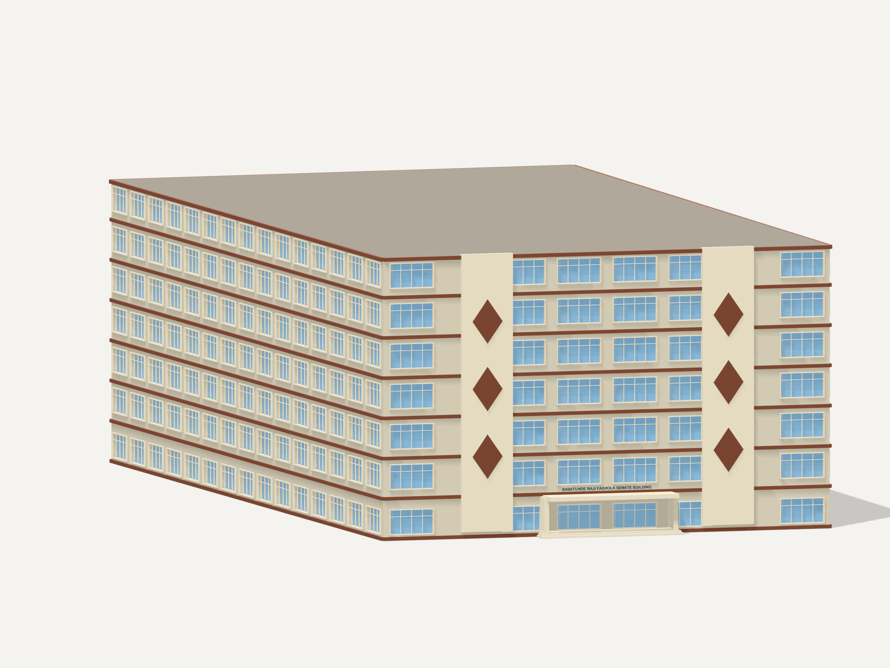
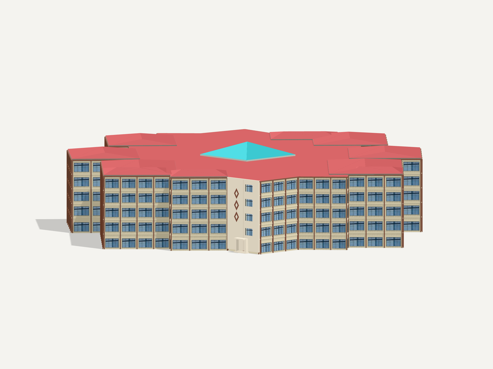
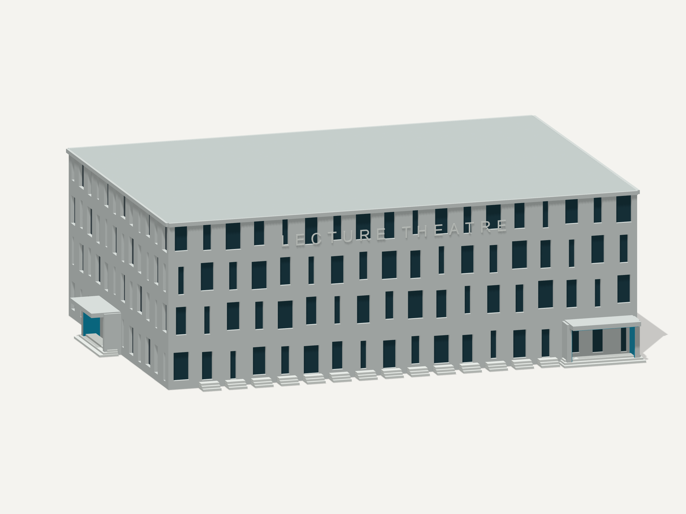

# LASU Ojo exterior model campaign

The modeling baseline is the published `lasu-41ec73876464` release: 614 building entries, 43 photographs and 23 photo-linked building IDs. The owner confirmed on November 1, 2026 that this release is current. The older 379-building local seed is preserved. Modeling changes do not alter geographic footprints, destinations or routing.

The [inventory](../data/lasu-models/inventory.json), [photo audit](../data/lasu-models/photo-audit.json), [observations](../data/lasu-models/observations.json), [editor reconciliation](../data/lasu-models/reconciliation.json) and [recipes](../data/lasu-models/recipes.json) preserve stable IDs and evidence. Individual dossiers are under `data/lasu-models/evidence/`. Native masters, source photographs, exports and private comparisons are stored at `C:\Users\user\Documents\TurnRight-Models\LASU-Ojo\`.

The current private batch contains 20 artifact proposals and three identification holds. Integration fixture `lasu-model-campaign-81395b5c763616e0` contains 215 immutable assets totaling 44,852,467 bytes (42.8 MiB), including the compatible baseline, all detail levels and textures. The owner has authorized publication, and the [guarded model publication workflow](MODEL-CAMPAIGN-PUBLICATION.md) provides read-only inspection, pinned preparation, atomic draft import and audited review. These models have not yet been applied or released by that workflow; no independent architectural acceptance is asserted.

| Senate Building proposal                                                                                                           | International Library proposal                                                                                                                               | Makanjuola Lecture Theatre proposal                                                                                                |
| ---------------------------------------------------------------------------------------------------------------------------------- | ------------------------------------------------------------------------------------------------------------------------------------------------------------ | ---------------------------------------------------------------------------------------------------------------------------------- |
|  |  |  |

These are unchanged 2400 × 1800 TurnRight renders; [current image hashes, model identities and texture credits](assets/lasu-models/publication-renders-2026-11-01.json) accompany them. Senate and Library use the compacted editable sources described below; the unchanged theatre image is reused. The [earlier pilot images and manifest](assets/lasu-models/pilot-renders-2026-11-01.json) remain intact as history. Senate glazing derives from [Aimee.shot.it's photograph](https://commons.wikimedia.org/wiki/File:Lagos_State_University_Senate_Building.jpg); Library glazing derives from [FrankvEck's photograph](https://commons.wikimedia.org/wiki/File:Lagos_State_University_Babajide_Olusola_Sanwo-Olu_Library_Complex_aug_2026_IMG_5994b.jpg), both [CC BY-SA 4.0](https://creativecommons.org/licenses/by-sa/4.0/). Small glazing samples were rectified, resampled and repeated across estimated modules. The theatre embeds no source photograph. Private comparison sheets retain observation-only references separately.

## Evidence and fidelity

Senate, International Library and Makanjuola Lecture Theatre are the pilots. The initial inventory has three identification holds: the clinic photo is an interior associated with Epe; the sports polygon covers the field rather than the photographed hall; and the School Library footprint is not securely matched to the photographed Main Library frontage. Additional science buildings and the printing press remain identification gaps until a stable Ojo footprint is established.

The [follow-up research record](../data/lasu-models/research-followup.json) checks official department references and the Ojo health-services website. Names and department affiliations corroborate building identity, but do not establish exact footprints. The health site's inspected images show an interior and a logo, so they do not resolve the clinic's exterior-evidence hold.

Photographs used for observation are distinct from photographs permitted for redistribution or texturing. Legacy “Public domain” labels on official and architect images do not establish permission. Only verified photographic crops carry texture provenance and credits into the public model descriptor. Comparison sheets containing observation-only photographs remain private. Construction photographs and the library's October 2025 aerial retain their dates. The aerial supports the red wing roofs and turquoise central atrium roof; exact ridges and current rooftop equipment remain unresolved. The Faculty of Education's July 2025 courtyard photograph supports covered walkways and deep fins; assigning that view to either mapped court remains an estimate. The law clinic proposal follows its dated March 2022 cream facade, with the undated dark cladding retained as conflicting evidence.

Every proposal records observed features, estimated dimensions, unseen elevations and uncertain facade orientation. Architectural comparison and an exact-snapshot review remain release requirements. The existing workflow supports independent approval or an explicitly audited original-owner override; the latter does not establish independent architectural acceptance. A completed export is not architectural approval. A 1 cm conversion check concerns units and file conversion, not survey accuracy.

The final comparison pass corrected the library's three hollow diamond screens and their placement, the Education entrance roof, Arts arcade setbacks, theatre openings, Radio windows, Law Library glass blocks and lettering, PG entrance grille and SDG facade trim. Exact bay spacing, roof junctions, facade alignment and unseen elevations remain estimates. This visual QA checks the generated proposals against available images; it does not supply independent architectural acceptance.

## Reproduction

Use the repository's pinned Node 22 toolchain and installed SolidCraft 0.29.0 CLI. Each building is created through a separate headless MCP session with strict parameter checking and a bounded archive path. Native commands, appearances, measurements and parameter regeneration results are retained. Successful runs are versioned by recipe hash; a failed run does not replace the previous native master.

```powershell
node scripts/solidcraft/inventory.mjs
node scripts/solidcraft/research.mjs
node scripts/solidcraft/references.mjs
node scripts/solidcraft/reconcile.mjs
$lasuModels = 47,44,25,54,39,31,73,3,2,55,120,78,76,75,28,22,43,103,33,32
node scripts/solidcraft/build.mjs $lasuModels
node --import tsx scripts/solidcraft/import.mts $lasuModels
node --import tsx scripts/solidcraft/render.mts $lasuModels
node scripts/solidcraft/evidence.mjs
node scripts/solidcraft/deliver.mjs
node --import tsx scripts/solidcraft/bundle.mts $lasuModels
node --import tsx scripts/solidcraft/verify.mts
node --import tsx scripts/solidcraft/verify.mts --hardware
```

Numeric arguments select stable `arcgis:University_Property` IDs. SolidCraft emits millimetre, Z-up `.sc`, OBJ/MTL and STEP files. TurnRight imports local metres, preserves named component provenance, assigns PBR materials and verified photographic crops, and exports embedded-texture GLB in standard Y-up coordinates. Seven standard 2400 × 1800 views and a reference-facing comparison view accompany each rendered model. Native OBJ export uses SolidCraft's standard chord tolerance; exact editable solids remain in the native and STEP masters.

Senate and Library required decimal mesh compaction to fit the unchanged **25 MiB private-document limit**. Their editable JSON sizes fell from 30,727,170 to 23,576,481 bytes and from 26,467,701 to 21,083,740 bytes, respectively. A one-micrometre position grid introduced maximum vertex displacements of **0.827 µm** and **0.741 µm**; topology, object/face identities, triangle counts, normals and winding checks remain intact. Native CAD and STEP masters are unchanged. All 20 editable documents now fit the limit and total 219,235,420 bytes. Their import records preserve original/output hashes and numerical errors; this precision is unrelated to survey accuracy.

The integration script writes a private fixture and editor proposal under the archive. It verifies all baseline assets and checks unchanged geographic geometry and routing. It does not modify the live release or the repository's public campus packages. Rebuild the integration fixture after changing any model or detail descriptor.

The delivery script writes `review.html`, `CAMPAIGN.json`, and a hashed `BUNDLE.json` plus texture credits in each eligible building's directory. It rejects stale imports or renders. The gallery links the editable masters, portable exports, comparison sheets and all seven standard views. These files are proposals for architectural review, not approval receipts. The archive also retains every earlier native run under its recipe hash.

Portable review archive `LASU-Ojo-model-proposals-v0.3.0-r2.zip` is 319,640,417 bytes with SHA256 `775892ae62dc5a8ff857d7439108873a3794241b2f0850be87f23e77ae2e84fd`. All 569 entries passed byte/hash readback. Its export manifest and receipt record both compactions and the per-document limit. It contains masters, exports, command logs, editable models, detail assets, model renders and credits; 40 private comparison/reference sheets, original photographs and `review.html` are excluded. The original v0.3.0 ZIP and receipt remain unchanged.

## Reader and package contracts

Model objects optionally classify their geometry as structural, facade or fine detail. Unclassified objects retain their existing behavior. Imported meshes support selected-face planar photo projection with crop preview, apply/cancel, recovery and a single undoable commit. Material changes invalidate model review through the existing document revision path.

`VisualCatalogue.detailedModels` is optional and versioned. Each building supplies its geographic origin and bounds, geometry/detail revisions, three levels, conservative geometric-error bounds, triangle counts and immutable asset descriptors. Geometry is losslessly welded and split into bounded chunks before gzip compression. Hashes and download sizes describe compressed bytes; decoded sizes are checked before JSON parsing. Texture descriptors retain dimensions, sampler-instance accounting and photographic credits.

The renderer prioritizes selected visible buildings, shares four request slots, aborts obsolete work and waits for verified textures before hiding compatible base geometry. It targets one CSS pixel of projected error, permits coarser levels under sustained frame pressure and uses a 256 MiB geometry/texture budget including mipmaps. Models share the existing MapLibre/Three context. After WebGL restoration, the custom layer is re-added only after MapLibre has rebuilt its style.

Compatible base visuals retain their 12 MiB limit. Detailed files are validated separately and listed once in the manifest total. Offline installation includes every published level and texture by default. All assets and model dependencies must pass verification before the active-package pointer changes; interrupted downloads can reuse verified files and failures preserve the previous valid package. Older readers can continue using the base visual group. Deploy compatible readers before publishing detailed releases.

Application-build preservation also validates the detailed catalogue before copying its assets. Detail-only files are excluded from the unchanged 200-file/25 MiB compatible-package guard; a texture shared with base visuals still counts against the base limit and appears only once in the manifest total. The complete 42.8 MiB campaign fixture passes preservation and hash read-back. Regression tests cover shared textures, invalid groups, catalogue mismatches and corrupted assets without replacing the previous active package.

The actual edit-to-publication path is also checked locally: immutable asset hydration, release validation, public-field sanitization and compilation of all three detail tiers retain all 20 exact model revisions. The private editable sources total 219,235,420 bytes, while the sanitized public navigation JSON is 4,551,071 bytes. Private editable documents and asset references are excluded from that public JSON. This check uses mocked immutable storage and reconstructs editable layer defaults from the published baseline; routing is compared against the equivalent no-model control, not asserted to be byte-identical to the original published graph. Read-only live preparation subsequently passed for the pinned archive and all 20 models, checking private corrections, existing model drafts, image permissions and storage without applying edits.

The complete release-builder dry run regenerated all 614 base buildings into 42 sectors. Base geometry, textures and scenery total 10,837,957 bytes, within the unchanged 12 MiB limit. The actual package writer produced 44,849,096 bytes across 215 verified assets, including all 20 models, three levels and 43 photographs. Model origins, bounds and triangle counts match the exported descriptors; footprints, routing semantics and photos match the control. The visual builder took 106.3 seconds against its 120-second worker timeout. This dry-run package is distinct from the browser fixture and has not been published.

## Verification and release

The [local validation record](../data/lasu-models/validation.json) pins the 606 delivered files, native/portable master hashes, conversion errors, integration fixture and measured browser runs. The archive contains 967,197,732 bytes of model bundles, separate from the 42.8 MiB offline map package. Recorded local checks and the normal production build passed; that build's 236 existing public assets matched the pre-build audit. These receipts retain the source revisions they tested. [Current-head hosted checks and deployment review](https://github.com/mrglasswillbreak/TurnRight/pull/61) remain authoritative for merging and deploying the software. No local receipt substitutes for architectural approval or physical-phone acceptance.

The private browser harness exercises simultaneous models, selection, camera movement, themes, resource release, WebGL recovery, complete downloads and offline rendering. Reports identify the fixture, source snapshot, browser, GPU and viewport. All 20 models rendered offline in both viewports, and three navigation cycles released all detailed geometry/texture reservations. Chromium SwiftShader results are software-rendered simulations, not physical-phone acceptance.

The current compacted fixture's November 1 Intel Iris Xe run measured **32.06 FPS at 1280 × 800** and **50.53 FPS at 390 × 844** during a 12-second camera sweep. The desktop measurement recorded 19 visible detailed models and one pending request; the phone viewport displayed 17. The desktop's 95th-percentile frame time was 86.7 ms with a 170.1 ms maximum; the phone viewport's values were 39.6 ms and 418.4 ms. These averages do not establish sustained 30 FPS or a fully loaded 20-model sweep. All 20 models were separately visited offline in both viewports, and complete download verification, theme changes, selection, WebGL recovery and three resource-release cycles passed. Source snapshot `2aaccac986af4d7ef70ec8babec2389b0d8196a1a2a2fc56b69592c1885a3d5e` identifies this run. The phone viewport uses the laptop GPU and is not a physical-phone result.

The earlier corrected fixture `lasu-model-campaign-5ecef4f63b9efb2a`, before the two document compactions, measured **50.0 FPS at 1280 × 800** and **60.1 FPS at 390 × 844** on November 1. Its desktop sweep displayed all 20 models; the narrower viewport displayed 17, with all 20 separately visited offline. Maximum frame times were 131.9 ms and 25.9 ms. Source snapshot `d64c5f7c7e66fed7a0e6c6053b4076dbdcb1cf3c178747a984911fefb8bd5e43` and its original reports remain as history; they do not describe the current fixture's measurement.

The historical November 1 runs, before the final facade corrections and isolated release checkout, include slow results as well as later profiles. The complete software-rendered workflow averaged 7.8 FPS at 1280 × 800 and 28.2 FPS at 390 × 844. Its Intel Iris Xe counterpart averaged 11.5 and 59.8 FPS. An isolated GPU profile after visiting every building measured 50.0 then 37.9 FPS on repeated desktop sweeps, and 60.1 then 48.6 FPS in the phone viewport. Those sweeps use the same 12-second camera movement after streaming settles. The latter profile retains a 1.92-second desktop stall and a 1.67-second phone-viewport stall; average frame rate does not hide those pauses. Earlier results remain in the archive. These measurements do not establish uniformly smooth performance or physical-phone acceptance.

The optional `--hardware` run records the host GPU identity and reports separately from SwiftShader. A phone-sized viewport remains an emulation even when rendered by the host GPU. Benchmark after assets settle and without concurrent CAD or test jobs. Physical-phone acceptance remains a separate required measurement.

For a CPU profile and repeated camera sweep, run `node --import tsx scripts/solidcraft/verify.mts --hardware --benchmark-only --profile --after-visits`. Omit `--after-visits` to start from a fresh overview. Diagnostic reports preserve individual frame times and browser heap measurements; this mode does not claim the complete offline/recovery workflow passed. Private Vite servers exclude archived copies under `web/work/` from file watching.

The actual editor journey in `web/tests/browser/editor-model-detail.spec.ts` exercises selected-face photo projection, preview/cancel, source provenance, undo/redo, GLB export and decoded PNG dimensions. Render downloads are invalidated when the model, view or output size changes. Vite dependency discovery starts from `index.html` so private archive copies under `web/work/` cannot introduce another React installation into the running editor.

The November 1 dependency assessment updated Vitest and its matching browser/coverage packages to 5.0.5 and applied compatible fast-uri and serialize-javascript patches. Remaining audit findings concern the Workbox build chain (glob/minimatch, EJS/Jake and deepmerge). Their vulnerable paths receive repository-controlled build inputs here. The audit's suggested PWA downgrade is not a compatible remediation; those transitive major-version migrations need separate validation. No high or critical finding was reported by this assessment.

Run repository checks, relevant unit/component and package tests, the complete browser/coverage gates, WebKit/PWA checks and a normal production build. See [contributing](../CONTRIBUTING.md), [acceptance](ACCEPTANCE.md), [publication](GIS-PLATFORM.md) and the [guarded proposal import instructions](MODEL-CAMPAIGN-PUBLICATION.md). Preserve failures and unresolved evidence in the campaign records. Publish completed batches only through the existing exact-snapshot review and release flow; keep the previous release available for rollback.
