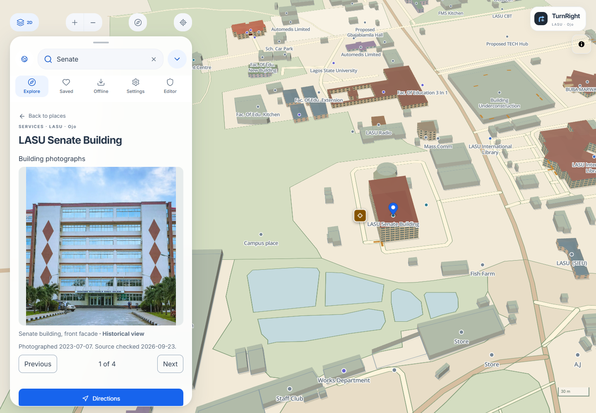

# Public map and globe

TurnRight lets visitors explore published campuses and use prepared maps offline. No account is required. Open [the public map](https://turnright.vercel.app/) or run the development seed using the [quick start](../README.md#run-locally).

The local [campus detail upgrade](CAMPUS-DETAIL-UPGRADE.md) adds **Map layers** controls with preferences saved per campus, a curated **Landmarks** filter and **View in 3D**. Decorative vegetation is illustrative and does not describe surveyed trees or route obstacles. LASU/UNILAG detail candidates still require private review and independent publication; their presence in local code does not mean the public packages have changed.

## Choose and explore a campus

Open **Choose a campus** beside search. Use the list, name search, globe pin, or published boundary to select a campus. The current map remains usable while another campus loads. Selection, URL, and remembered campus change only after successful loading. See [Campus globe](CAMPUS-GLOBE.md) for keyboard behavior, overlapping boundaries, failures, and browser history.

Search places or streets and browse available categories. Select a result or mapped building to inspect its name, source information, photos, available arrival guide, and route actions. Save places for return visits or share a campus-specific destination link. A building can be visible without a usable routing connection.

Use 2D/3D, zoom, orientation, appearance, and rendering controls to suit the device. Unknown building heights are illustrative; floor-derived dimensions and authored models are not measured access evidence. **Settings → Appearance** supports Device, Light, and Dark. Motion preferences and reduced-motion behavior are described in [Motion](MOTION.md).

## Plan a journey

Select a destination, open directions, and choose an origin. A manual origin supports planning without location permission. Walking and driving use mapped networks and restrictions; unavailable connections stay unavailable rather than inventing shortcuts. Driving can include parking and a walking handoff. See [Driving](DRIVING.md).

Allow location when using foreground guidance. Poor accuracy can pause progress; moving off a permitted route can trigger recalculation. Voice controls support repeat/mute and downloaded recorded phrases. Optional place-name speech depends on the device. See [Voice](VOICE.md).

Keep the app in the foreground. Screen locking or backgrounding can pause tracking. Campus switching during active directions requires stopping that journey. Cross-campus routing, indoor room navigation, and verified step-free directions are outside the supported scope. Treat a mapped approach separately from a verified usable entrance.

## Download before disconnecting

1. While online, select the campus and open **Offline**.
2. Download it and wait for verification and **Ready offline**. Review photo/model download options where offered.
3. Repeat for every campus needed. Seeing a campus in the directory does not download its package.
4. Reopen the app offline and verify map, search, routes, and voice before relying on it on site.

The app verifies package assets by size and hash. Interrupted downloads retain the previous usable package. Missing or evicted browser storage can require repair. An active journey stays on its current version while an update is prepared. Saved places, recents, reports, and downloads are campus-scoped. Removing one campus download leaves other campuses intact.

Team synchronization, source checks, analysis jobs, report submission, and publication require a connection. Offline browser storage is device-local and can be cleared by the browser or user; it is not a server backup. [Offline acceptance checks](ACCEPTANCE.md#local-and-desktop-browser-checks).

## Report a problem

Use the report action for a selected place or dropped pin. Explain the issue and location without unnecessary personal information. A saved draft can be reopened from **Settings → Saved report drafts**; reconnecting does not submit it automatically. Submitted reports enter private team review and cannot directly modify a route.

Source credits and photograph licences remain available in the app. TurnRight is independent of the universities it maps. Verify access restrictions, paths, and entrances on site; [acceptance](ACCEPTANCE.md) distinguishes browser evidence from physical-device and field checks.

The image above is a dated local application capture using attributed public assets and isolated fixtures. [Gallery and provenance](SCREENSHOTS.md) · [Arrival guides](ARRIVAL-GUIDES.md) · [Editor](EDITOR.md) · [Production status](PRODUCTION.md).
