# Application tour and screenshot maintenance

The current gallery shows the B2 campus identity across public navigation, team workspaces and supporting tools, alongside dated source-update and map-preview examples. Every image is a direct browser capture; no UI was painted over, assembled from separate screens, or generated. [Machine-readable capture records](assets/screenshots/b2-2026-10-11.json) provide dimensions, theme, revision, fixture and image hashes. [Historical captures](assets/screenshots/README.md) remain intact.

## Source reliability and private undo · 13 October 2026

| Desktop recovery | Phone recovery |
| --- | --- |
| 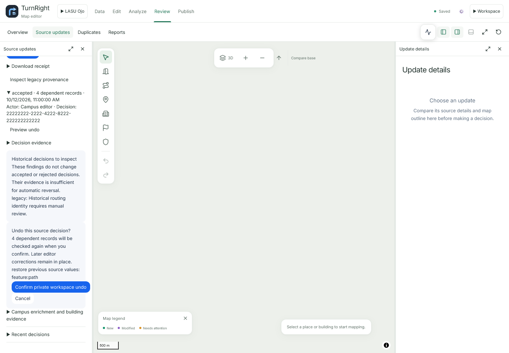 | 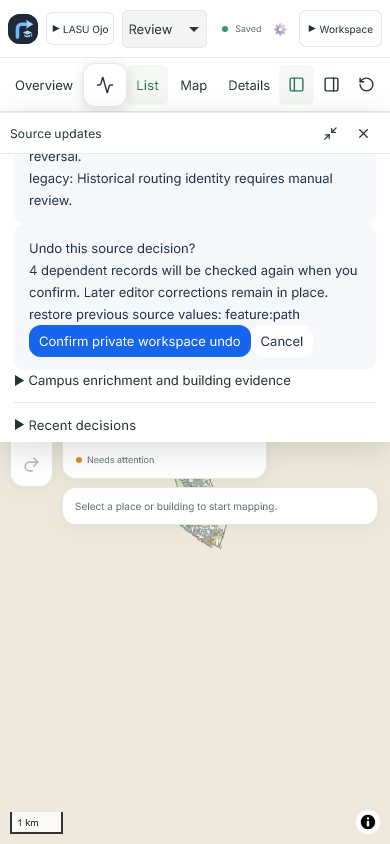 |

These direct WebKit captures use the local working tree and isolated owner/API fixtures: one blocked path, one incomplete check and one reversible decision. Counts and decisions are synthetic. No production data is changed. Phone uses a browser viewport, not a physical iPhone. [Capture provenance and hashes](assets/screenshots/source-reliability-2026-10-13.json).

Run `npm run test:survey-webkit -- tests/browser/editor.spec.ts --grep "source updates reliability" --output ../test-results/source-reliability-webkit` from `web/`. Run the same filter with `npm run test:browser` for Chromium. The journeys inspect exclusion of unverified removals, check receipts, a fresh verification request and a previewed private reversal. Broader `--grep "source updates"` journeys also cover frozen bulk decisions and read-only map comparisons.

## B2 campus identity · 11 October 2026

Nineteen fresh Chromium captures update the README and linked workflow guides. The shared arrow-and-graduation-cap mark appears in public navigation, editor headers, the offline panel and sign-in. Public/editor/model/GIS views use the verified LASU `lasu-4895a363b403` package with isolated owner/team responses; sign-in is captured without an account. Photo and import fixtures are described below. These captures show the local application, with deployment status recorded separately in [Production](PRODUCTION.md).

| Desktop navigation | Phone navigation |
| --- | --- |
| 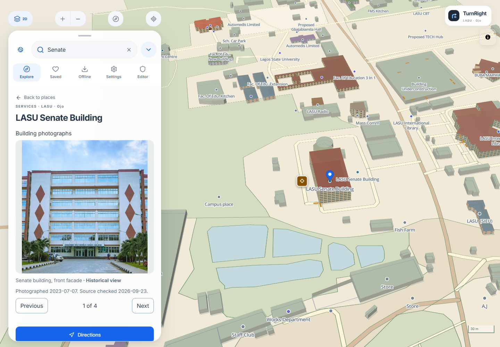 | 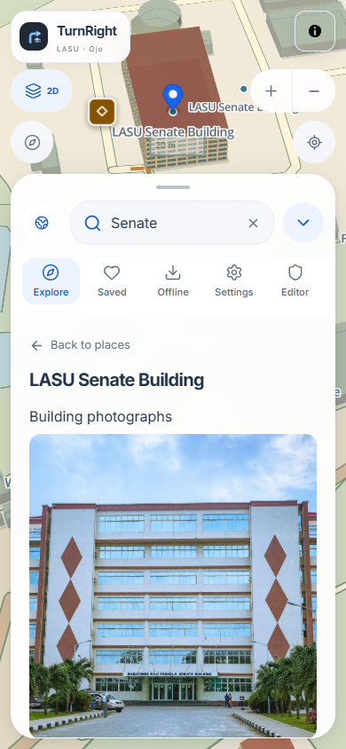 |

| Editor entry | Offline controls |
| --- | --- |
| 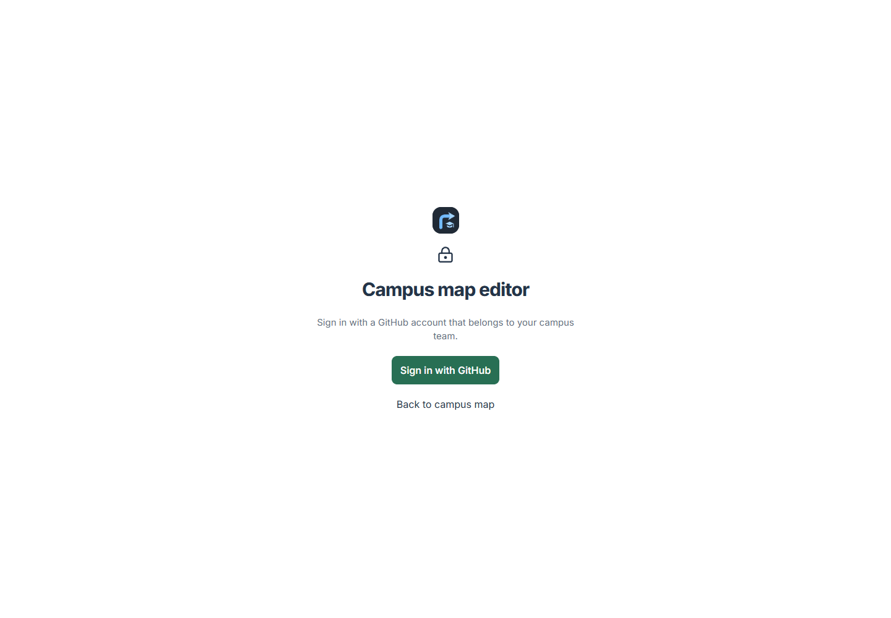 |  |

[Brand geometry, colours and platform icons](BRAND.md) · [Image and source hashes](assets/screenshots/b2-2026-10-11.json). Older source-update captures below retain their original dates and branding.

## Map previews and adjustable phone panels · 11 October 2026

| All matching source proposals | Phone map preview | Resized editing panel |
| --- | --- | --- |
| 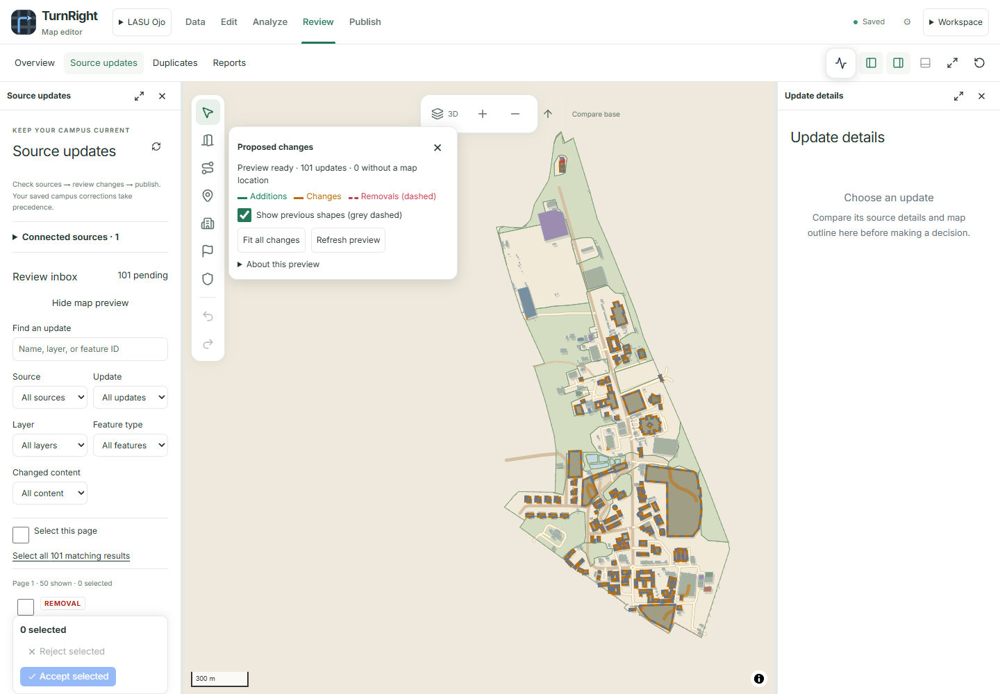 | 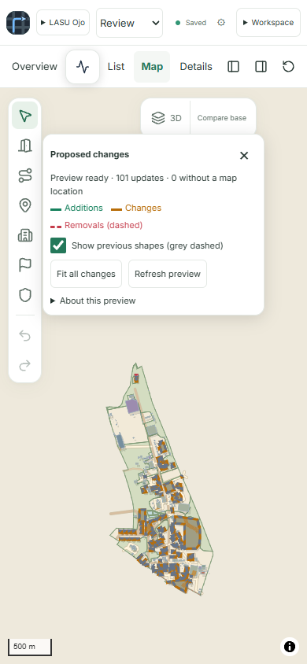 | 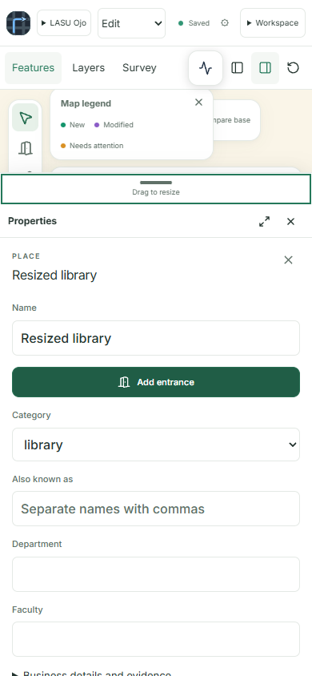 |

The preview captures show 101 synthetic proposals over the checked-in LASU `lasu-4e4c8008b38b` seed. The panel capture uses the small `browserCampus` fixture and a synthetic Library edit. These are unaltered local Chromium captures, not production decisions. [Source and image digests](assets/screenshots/source-map-preview-2026-10-11.json).

Reproduce with `npm run test:browser -- tests/browser/editor.spec.ts --grep "source updates map preview|workspace panes: mobile editing height" --output ../test-results/source-map-preview` from `web/`. Use `npm run test:survey-webkit` with the same arguments for WebKit. The independent preview journeys verify all pages, actual rendered source data, previous shapes and read-only closing; the resizing journey checks dragging, keyboard access, input preservation, reload and reset.

## Source updates capture workflow

The new [Source updates workspace](SOURCE-UPDATES.md) has desktop and phone capture journeys in `web/tests/browser/editor.spec.ts`. They use the real React/MapLibre interface with isolated owner/API responses and 101 synthetic proposals. The names, proposal counts, removals, decisions, and progress are demonstration data; no production proposal is reviewed by these tests.

Run sequentially from `web/` after installing the pinned dependencies and Playwright browsers:

```powershell
npm run test:browser -- tests/browser/editor.spec.ts --grep "source updates bulk review" --output ../test-results/source-updates-chromium
npm run test:survey-webkit -- tests/browser/editor.spec.ts --grep "source updates bulk review" --output ../test-results/source-updates-webkit
```

Each engine writes `source-updates-desktop.png`, `source-updates-mobile.png`, `source-updates-confirm-desktop.png`, and `source-updates-confirm-mobile.png` inside its per-test output directories. Desktop uses 1440 × 1000 and phone uses 390 × 844. The application regression workflow also retains them in its browser artifacts when the journeys reach the capture steps.

Inspect the actual captures and successful test results before promoting any image into this gallery. Use a new dated filename and record the exact commit, browser version, fixture identity, dimensions, and SHA-256 digest. Keep earlier images and manifests. The four October 11 captures below passed their Chromium desktop/phone journeys and were inspected individually. Their [capture record](assets/screenshots/source-updates-2026-10-11.json) identifies the tested commit, pinned browser, fixture and file digests. The October 7 captures remain dated examples of the earlier interface. [Rollout status](PRODUCTION.md#source-updates-rollout--11-october-2026).

## Source updates · 11 October 2026

| Inbox and comparison | Bulk confirmation |
| --- | --- |
| 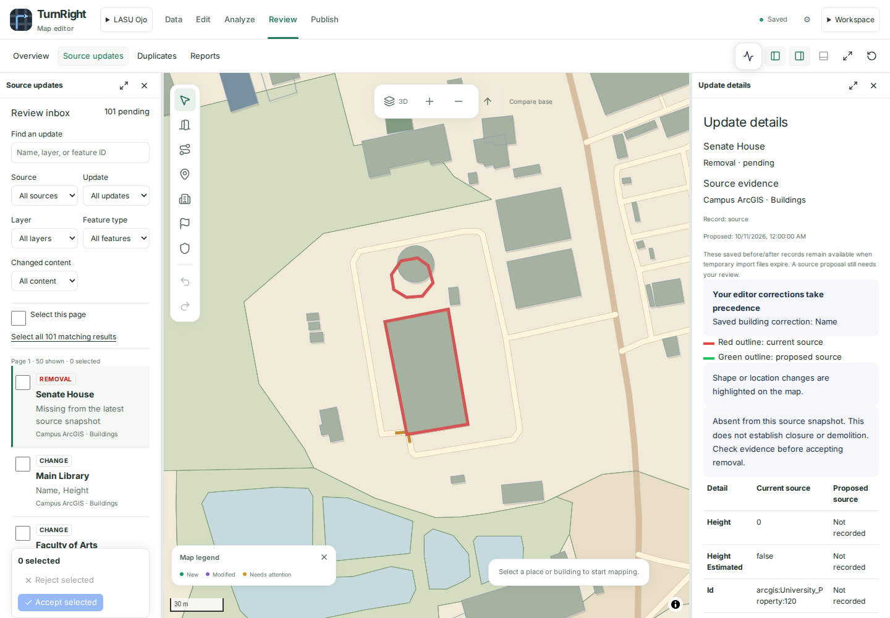 | 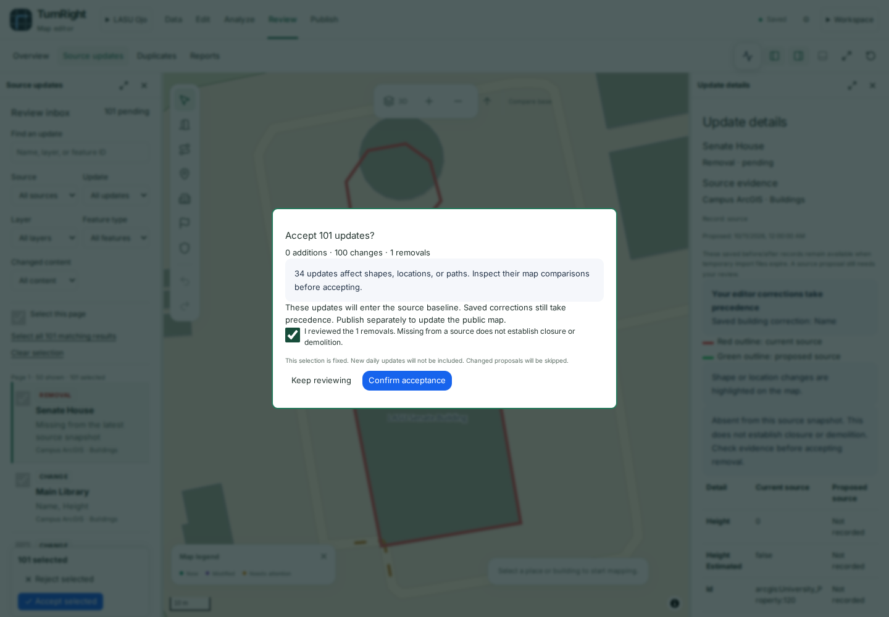 |
| 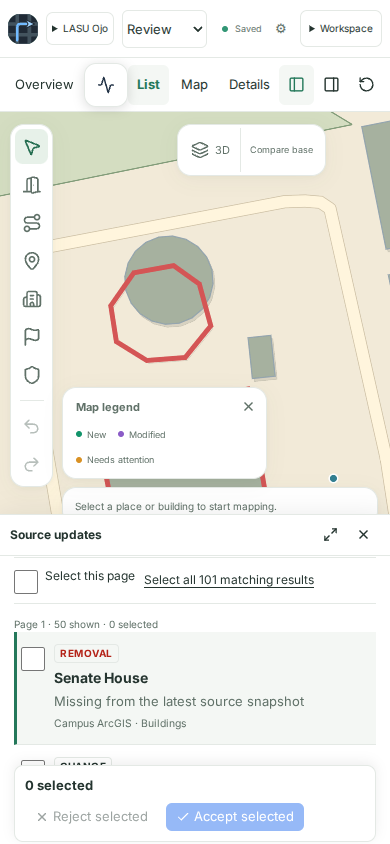 | 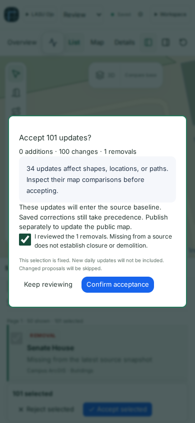 |

These unaltered captures use the Vite development server at commit `1feb53f77c954698c0c6d6dd3074db85a06399db`, the published LASU package, and isolated owner/API fixtures with 101 synthetic proposals. They establish the appearance of the tested interface, not a production decision or deployment.

## Visual tour

| View | What it demonstrates | Capture |
| --- | --- | --- |
| Public desktop | Place search, building details and public navigation | [1440 × 1000, light](assets/screenshots/b2-public-desktop-2026-10-11.png) |
| Public mobile | A selected place in a phone viewport | [390 × 844, light](assets/screenshots/b2-public-mobile-2026-10-11.png) |
| Edit | Feature explorer, map and contextual properties | [1440 × 1000, light](assets/screenshots/b2-editor-desktop-2026-10-11.png) |
| Data | Datasets, map, attributes and schema/export controls | [1440 × 1000, light](assets/screenshots/b2-gis-data-2026-10-11.png) |
| Model reference split | Structure, model, photograph and inspector | [1440 × 1000, light](assets/screenshots/b2-model-desktop-2026-10-11.png) |
| Photo comparison | File list, before/after canvas and compression settings | [1440 × 900, light](assets/screenshots/b2-photo-desktop-2026-10-11.png) |
| Review | Quality checks and independent immutable submissions | [1440 × 1000, light](assets/screenshots/b2-gis-review-2026-10-11.png) |
| Publish | Approved content, releases and map exports | [1440 × 1000, light](assets/screenshots/b2-gis-publish-2026-10-11.png) |
| Globe | Campus context at world scale | [1440 × 900, dark](assets/screenshots/b2-globe-2026-10-11.png) |
| Mobile editor | Workspace chooser and one active sheet | [390 × 844, light](assets/screenshots/b2-editor-mobile-2026-10-11.png) |
| Analyze | Tools, parameters and processing history | [1440 × 1000, light](assets/screenshots/b2-gis-analyze-2026-10-11.png) |
| Imports | Inspected fields in an isolated campus import | [1440 × 900, light](assets/screenshots/b2-imports-2026-10-11.png) |
| Model portrait | Selected wall in the full-screen model workspace | [390 × 844, light](assets/screenshots/b2-model-portrait-2026-10-11.png) |
| Model landscape | Selected wall in a short landscape viewport | [844 × 390, light](assets/screenshots/b2-model-landscape-2026-10-11.png) |
| Mobile photos | Full-screen photograph comparison | [390 × 844, light](assets/screenshots/b2-photo-mobile-2026-10-11.png) |
| Offline use | Package preparation and download controls | [390 × 844, light](assets/screenshots/b2-offline-2026-10-11.png) |

The [editor guide](EDITOR.md#legend-and-activity) also illustrates [collapsed legend](assets/screenshots/b2-legend-collapsed-2026-10-11.png) and [expanded Activity](assets/screenshots/b2-activity-expanded-2026-10-11.png) states. The normal editor view shows the collapsed Activity icon. The [sign-in screen](assets/screenshots/b2-signin-2026-10-11.png) verifies B2 before authentication.

## Provenance

Public, editor, model and GIS captures render the published **LASU lasu-4895a363b403** package and its attributed assets in the actual local application. Owner/team authentication and private API responses are isolated test fixtures. The GIS 100,000-row label demonstrates paged controls; it is not a campus inventory or performance measurement. Example submissions and approvals never modify production data.

Imports use `campus-imports.spec.ts`'s small synthetic campus, source and inspected-layer responses. Photos use the actual PhotoOptimizer component in `photo-harness.html` with the repository's *School of Communication exterior*: **Abiolakintrunde**, [CC BY-SA 4.0](https://creativecommons.org/licenses/by-sa/4.0/), [original photograph](https://commons.wikimedia.org/wiki/File:Lagos_state_university_school_of_communication.jpg), catalogue ID `commons:112540966`. The application resizes/compresses a private copy for comparison. Source rights and modifications remain in [photo records](../data/photos/README.md).

Phone views are browser viewports, not photographs of physical devices. The offline screenshot demonstrates the interface; prepared-package tests separately verify offline behavior. These local captures do not claim that this working-tree revision is deployed. See [Production](PRODUCTION.md) for deployment evidence.

## Reproduce

Use the pinned Node version, `npm ci` in `web/`, and installed Playwright Chromium/WebKit binaries. Public/model fixtures require the verified published assets under `web/work/model-benchmark/public`; preserve the package manifest and asset hashes when preparing that fixture. See the [existing fixture preparation record](assets/screenshots/README.md). Run these commands sequentially from `web/` (PowerShell):

```powershell
$env:TURNRIGHT_SCREENSHOT_PREFIX = 'b2'
$env:TURNRIGHT_SCREENSHOT_DATE = '2026-10-11'
node node_modules/@playwright/test/cli.js test --config playwright.redesign-docs.config.ts --output work/capture-public-editor
$env:TURNRIGHT_GIS_SCREENSHOTS = '1'
node node_modules/@playwright/test/cli.js test --config playwright.gis-docs.config.ts --output work/capture-gis
Remove-Item Env:TURNRIGHT_GIS_SCREENSHOTS
$env:TURNRIGHT_REDESIGN_SCREENSHOTS = '1'
node node_modules/@playwright/test/cli.js test tests/browser/campus-imports.spec.ts --grep 'responsive screens' --output work/capture-imports
node node_modules/@playwright/test/cli.js test tests/browser/photo-processing.spec.ts --grep 'photo comparison edits' --timeout=120000 --output work/capture-photos
Remove-Item Env:TURNRIGHT_REDESIGN_SCREENSHOTS
node scripts/record-screenshots.mjs
Remove-Item Env:TURNRIGHT_SCREENSHOT_PREFIX
Remove-Item Env:TURNRIGHT_SCREENSHOT_DATE
node scripts/check-docs.mjs
```

The public/editor and GIS galleries use configured production builds. Import and photograph fixtures use Vite's development server to expose their test harnesses. Keep each Playwright run's output directory separate; concurrent runs must not share an output directory or a server port.

## Maintenance checklist

- Give new captures a new date; never overwrite an older dated image to make historical evidence look current. Change the gallery's output date and record script together.
- Verify the intended viewport, theme, completed loading, legible labels, credits, and selected state. Inspect every image at native size; check phone and landscape controls for overlap and clipping.
- Use public or explicitly synthetic data. Do not capture private accounts, location histories, tokens, or production drafts. Label fixture counts and simulated states.
- Keep a concise caption and useful alt text wherever an image is embedded. Describe the feature shown, not the file name.
- Regenerate the record after the final captures. Record the base commit and working-tree source digest, browser version, fixture identities, image dimensions and SHA-256 hashes.
- Run the documentation link/asset checker and the relevant browser, offline and accessibility checks. Screenshots supplement behavioral tests; they do not replace them.
